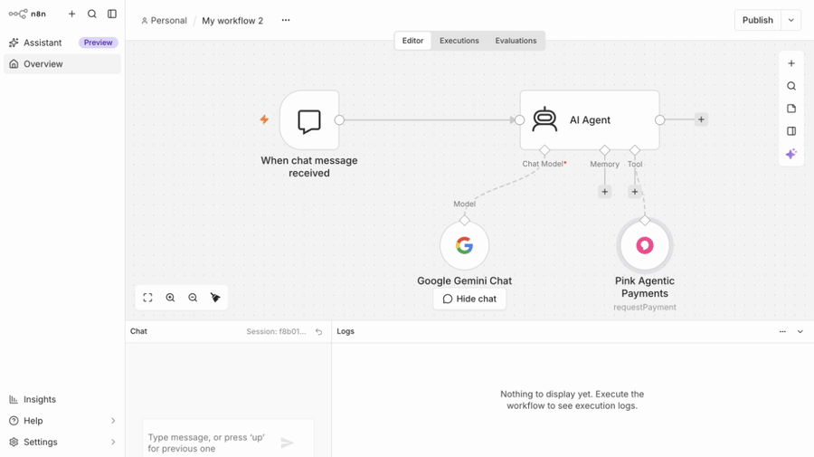

# n8n-nodes-pink

n8n community node for **Pink Agentic AI Payments** — the payment infrastructure by
PinkWallet that lets an AI agent or workflow pay within the spending rules a company
sets (per-agent monthly budgets, single-payment caps, payee allow-lists, human approval
above thresholds, a shared company daily ceiling). Every request this node makes is
checked against those rules before a payment credential is ever issued, and comes back
as one of three decisions: `allowed`, `pending_human`, or `blocked`, with the reason.

## See it run (1:49, uncut)



Full uncut demo: install from npm, credential test, $50 allowed / $350 blocked, then an AI Agent paying through Pink as a tool. Sandbox, test money.

[Watch the full 1:49 video](assets/demo/n8n-pink-demo.mp4)

> **Sandbox preview, test money only.** This node talks to
> `https://agentic-sandbox.pinkwallet.com` by default. No real money moves. Production
> is not yet available for this product.

Docs hub: https://pinkwallet.com/agentic/developers/

## Installation

Install via the **n8n Community Nodes** UI:

1. Go to **Settings → Community Nodes**.
2. Select **Install**.
3. Enter `n8n-nodes-pink`.
4. Agree to the risk disclaimer and select **Install**.

Or manually, in a self-hosted n8n instance:

```bash
npm install n8n-nodes-pink
```

## Credentials

Add a **Pink Agentic Payments API** credential:

- **Base URL** — defaults to `https://agentic-sandbox.pinkwallet.com` (the sandbox).
- **Agent API Key** — an agent key from a Pink sandbox workspace (looks like
  `pk_sandbox_agent_...`). Get one for free, no signup, by creating a sandbox
  workspace: `POST https://agentic-sandbox.pinkwallet.com/v1/sandbox/workspaces`. See
  the docs hub above for the full request/response shape.

## Node: Pink Agentic Payments

`usableAsTool: true` — an n8n **AI Agent** node can call this node directly as a tool,
so an LLM-driven agent can request payments itself, still checked against the same
rules.

### Operations

- **Request Payment** — `amount`, `currency`, payee (`Payee ID` or `Payee Name`),
  `purpose`, optional `idempotencyKey` → a decision (`allowed`, `pending_human` or
  `blocked`), `payment_id`, the matched `rule`, and on `pending_human` the `who`
  (approver) and on `blocked` the `why`.
- **Check Policy** — the same inputs as Request Payment, but dry-run only: no spend, no
  side effects. Returns a `would_allow` / `would_ask` / `would_block` decision plus a
  human-readable `trace` of every policy rule the engine checked.
- **Get Budget** — this agent's `monthly_budget`, `spent_this_month`,
  `left_this_month`, `single_payment_cap`, and vault balance.
- **Get Payment Status** — look up a payment or hold by `paymentId`, to poll a
  `pending_human` hold until a human approves or declines it.

### Example workflow

[`examples/pay-invoice-within-rules.json`](examples/pay-invoice-within-rules.json) — a
manual trigger calls **Request Payment**, then an **IF** node branches on
`$json.decision` to either use the issued sandbox credential (`allowed`) or surface the
reason (`blocked` / `pending_human`). Import it via **Workflows → Import from File**.

## Development

```bash
npm install
npm run build
npm run lint
```

## License

MIT
